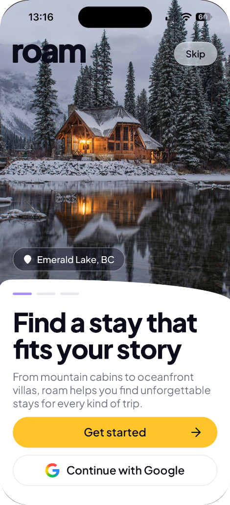
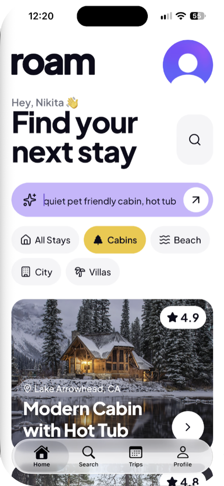
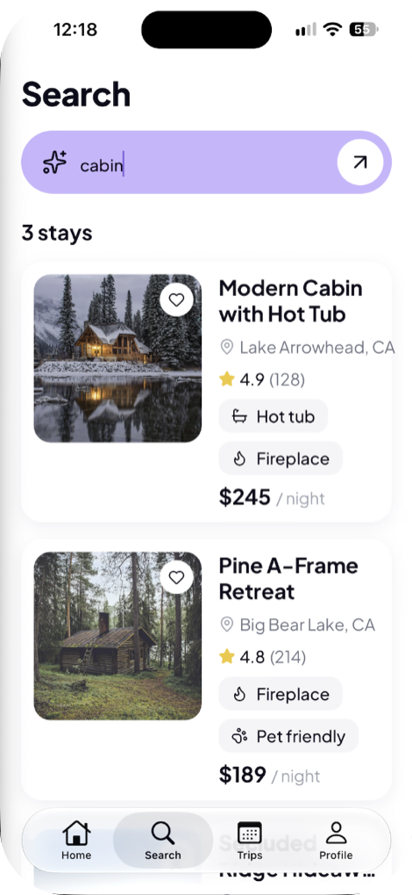

<div align="center">

  <div>


<br />


  </div>

  <h3 align="center">Roam</h3>
  <p align="center">An Airbnb-style app where you search for stays in plain English</p>
  <p align="center">
    <a href="https://appetize.io/app/b_b7zfddw7bswku4lj3xi77rd5ba"><b>Try iOS in your browser</b></a>
    ·
    <a href="https://expo.dev/artifacts/eas/VtD14lRh4vpc0vxu6uSPwfyMfl1h0DcCE4ZgMr2UHN0.apk"><b>Download the Android APK</b></a>
  </p>

  
  
  
</div>

## About

Roam is an Airbnb-style app for iOS and Android. There are no filters or dropdowns. You type what you want, say "a quiet cabin with a hot tub that allows dogs, under $300 a night", and the search finds stays that match.

Every listing also has a chat. Ask "can I bring my pet?" and the answer comes from that stay's own policies.

When you find a stay you like, you pick dates and pay for it in the app. Hosts get their own side of the app, where their team edits the stays they own.

I'm building it with a coding agent: I write a plan first, then add one feature at a time so the codebase stays something I understand. Auth, content, analytics and AI all run on real services.

## Try it

- **iOS:** [open the app in your browser](https://appetize.io/app/b_b7zfddw7bswku4lj3xi77rd5ba). It streams an iOS Simulator from Appetize, so there's nothing to install.
- **Android:** [download the APK](https://expo.dev/artifacts/eas/VtD14lRh4vpc0vxu6uSPwfyMfl1h0DcCE4ZgMr2UHN0.apk) on your phone and install it. Android will ask you to allow installs from your browser.

Sign up with any email you can read: Roam sends a code to verify it. Payments use Stripe's test mode, so pay with the card `4242 4242 4242 4242`, any future expiry date and any CVC. No real money moves.

In this demo, a paid booking shows "Payment received" but doesn't appear on Trips. Bookings are confirmed by a Stripe webhook, and the demo server doesn't have one registered yet.

## Stack

- [React Native](https://reactnative.dev/) and [Expo](https://expo.dev/) for one codebase that runs on iOS and Android.
- [TypeScript](https://www.typescriptlang.org/), which makes agent-written code easier to review.
- [NativeWind](https://www.nativewind.dev/) for Tailwind-style classes in React Native.
- [Clerk](https://clerk.com) for sign-up and sign-in. Saved stays are tied to the user's Clerk account, and host companies are Clerk Organizations.
- [Sanity](https://www.sanity.io) holds the listings and generates the embeddings for search. Its content is also what the property chat answers from. Listing descriptions are written by Sanity's Agent Actions from each stay's facts, and kept only if a check finds nothing made up. Bookings live in a separate private dataset.
- [Stripe](https://stripe.com) for payments. A booking is confirmed only when Stripe's webhook says the payment went through.
- [EAS](https://expo.dev/eas) builds the apps and hosts the API routes (booking, trips, host edits) on EAS Hosting.
- [PostHog](https://posthog.com) for analytics, from a user's first search to the stays they save.

## What it does

- Search for stays by describing them in plain English
- Chat with a listing and get answers based on its policies
- Sign up and sign in with email, Google or Apple
- Browse a feed of stays
- Narrow a search with chips, a filter sheet and sort options
- Open a stay to see its photos, details, policies and host
- Book a stay: pick dates and guests, pay with Stripe, and get a confirmed booking
- See upcoming and past trips, plus the stays you saved, on the Trips tab
- Edit your profile (photo, name, home city), sign out of other devices, or delete your account
- Host mode: a host company's team edits its stays' price, guest count, pets, amenities, check-in times and house rules, and admins invite or remove teammates
- Track how people use the app with product analytics

## Running it locally

You'll need [Git](https://git-scm.com/), [Node.js](https://nodejs.org/en) and [npm](https://www.npmjs.com/).

Clone the repo:

```bash
git clone https://github.com/yeldynov/roam.git
cd roam
```

Install dependencies:

```bash
npm install
```

Copy `.env.example` to `.env.local` in the project root and fill it in:

```env
EXPO_PUBLIC_CLERK_PUBLISHABLE_KEY=
CLERK_SECRET_KEY=
CLERK_JWT_KEY=
EXPO_PUBLIC_POSTHOG_PROJECT_TOKEN=
EXPO_PUBLIC_POSTHOG_HOST=https://us.i.posthog.com
EXPO_PUBLIC_STRIPE_PUBLISHABLE_KEY=
STRIPE_SECRET_KEY=
STRIPE_WEBHOOK_SECRET=
SANITY_BOOKINGS_TOKEN=
SANITY_API_WRITE_TOKEN=
```

Only the `EXPO_PUBLIC_` values go into the app. The rest stay on the server, in the app's API routes.

Fill in the values from your own [Clerk](https://clerk.com), [Sanity](https://www.sanity.io), [Stripe](https://stripe.com) and [PostHog](https://posthog.com) accounts.

Start the dev server:

```bash
npx expo start
```

To test bookings, forward Stripe's webhooks to the dev server in a second terminal, and put the `whsec_` secret it prints in `STRIPE_WEBHOOK_SECRET`:

```bash
stripe listen --forward-to localhost:8081/api/stripe/webhook
```

Then scan the QR code with Expo Go on your phone, or press `i` for the iOS Simulator or `a` for the Android emulator.
